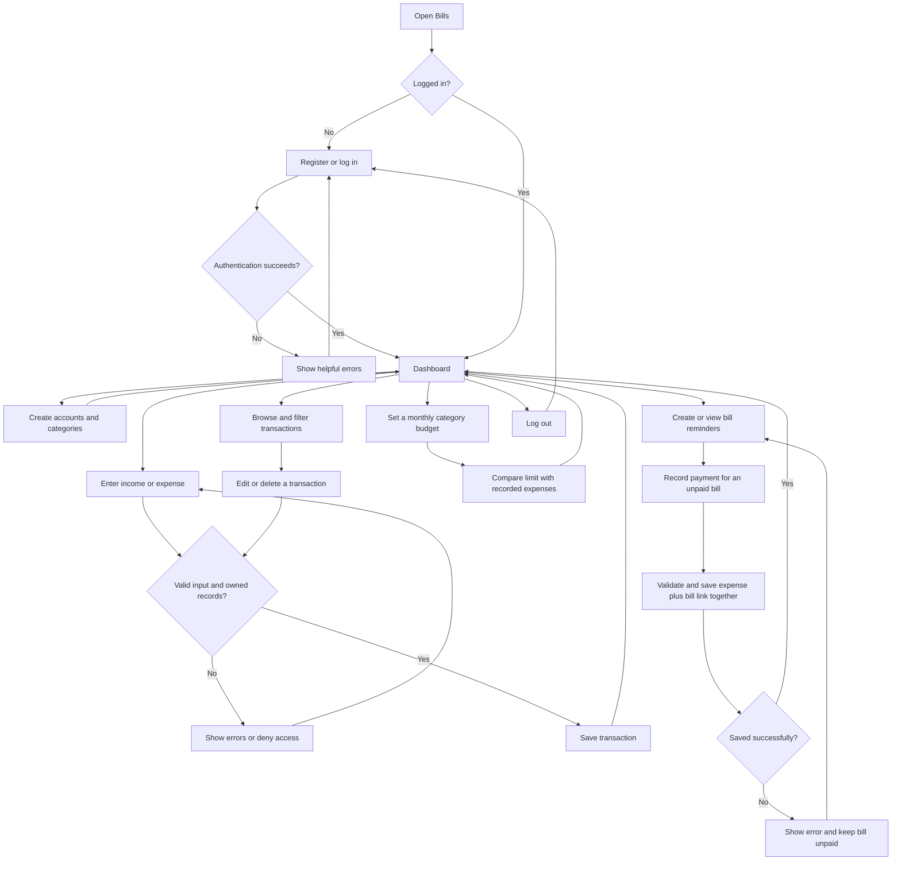

# Planned user flow

**Status: every screen and action in this diagram is planned.**

## Why this flow?

- Authentication comes before private data. A successful login identifies whose accounts, categories, and transactions may be used.
- Account setup comes before transaction entry because each transaction needs a place where money moved. An empty dashboard should explain this next step.
- The dashboard is the return point so users can see the effect of a change immediately.
- Validation errors should appear beside form fields and preserve entered values. Access denials should not expose another user's record details.
- Editing and deleting need the same ownership checks as creating and viewing. A delete action should explain its effect before confirmation; deleting a paid bill's transaction should be blocked until the payment is deliberately undone.
- Recording payment is one database transaction: either the expense and bill link both save, or neither saves. This prevents a reminder appearing paid without a matching expense.
- Ordinary bill reminder creation, budget changes, and account/category changes also require validation and ownership checks; their error branches are omitted to keep the diagram readable.

The reminder list is planned to derive `paid` from a linked payment, `overdue` from an unpaid due date before today, and `upcoming` from an unpaid due date today or later. Store the underlying facts instead of a status that can become stale overnight.
