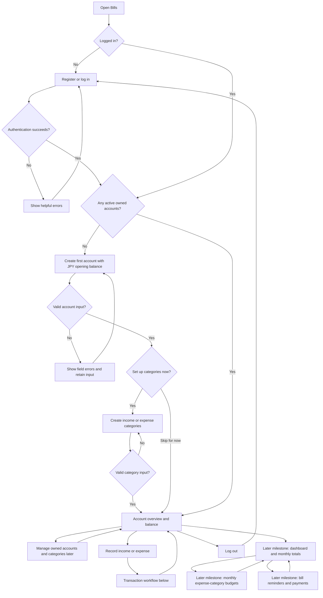
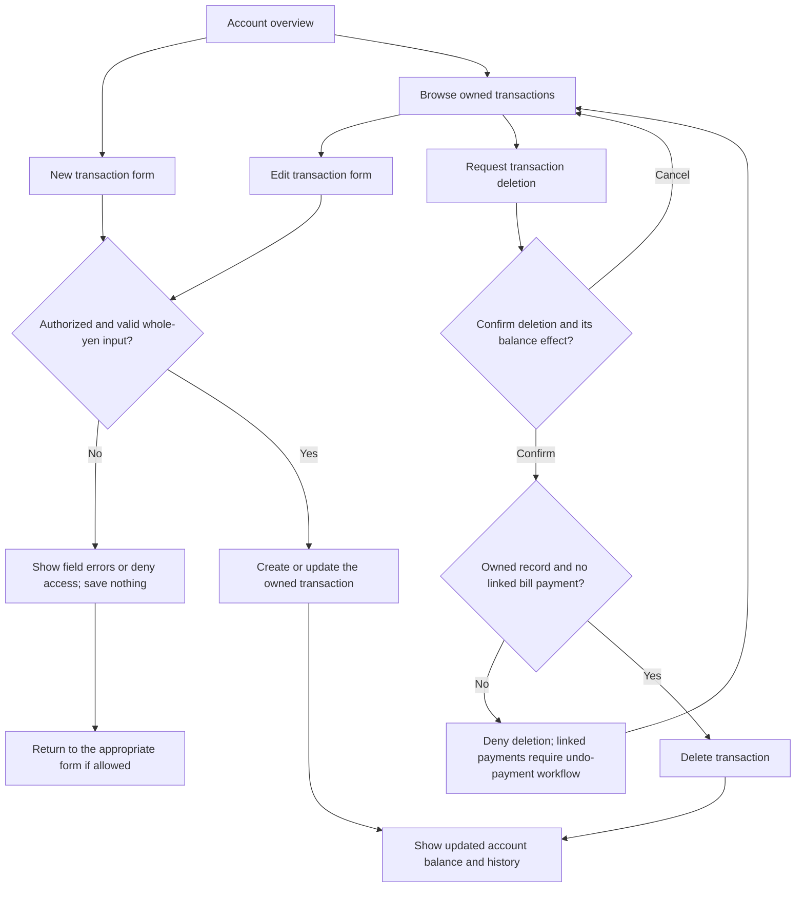
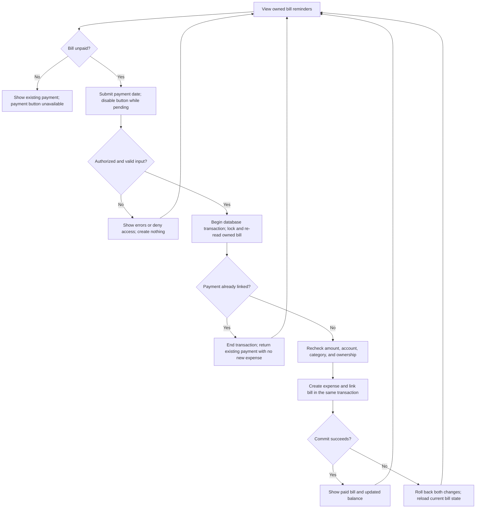

# Planned user flow

**Status: every screen and action in these diagrams is planned.**

## Planned login and first-time setup

The first functional milestone is **log in → create an account → record an expense → view the updated account balance**. The account page will show that balance before the full dashboard milestone. Category setup is offered but optional for transactions.

## Planned transaction creation, editing, and deletion

An edit of a linked bill payment's financial fields is also blocked until payment is undone. Neither the browser's confirmation nor a hidden button replaces server authorization. All transaction lists and summaries must be owner-scoped too.

## Planned bill payment and repeat-submission handling

If rechecking fails after the lock, roll back and show an error without creating an expense. While pending, the UI should show progress; after any response it should refresh the authoritative bill state. A network timeout does not prove payment failed: reload first, and let any retry go through the same server check. This handles double-clicks, retries, and requests from multiple browser tabs without relying on the disabled button.

Undo payment is a separate planned action with explicit confirmation. It must authorize, lock and re-read the bill, clear its payment link, and delete the linked expense in one database transaction. A repeat undo must not remove any unrelated transaction. A paid reminder cannot be deleted until payment has been undone; an unpaid reminder can be deleted after confirmation without changing balances.

## Why this flow?

- Authentication comes before private data. A successful login identifies whose accounts, categories, and transactions may be used.
- A new user is directed to account creation before transaction entry because each transaction needs a place where money moved. Explain the opening balance and offer categories next, with a clear skip option. Do not silently create example financial records.
- If the user has no categories, the transaction form should offer category creation or an uncategorized entry. Budgets and bill reminders require an expense category and should point to setup when none exists. Any workflow requiring an account should similarly point to account setup if no active one exists.
- The account page is the first return point so users can see a balance change immediately. A later dashboard adds cross-account monthly summaries.
- Validation errors should appear beside form fields and preserve entered values. Access denials should not expose another user's record details.
- Editing and deleting have separate paths. Deleting needs explicit confirmation and a server check that the transaction is not a linked bill payment. Referenced accounts and categories are archived instead of deleted, and archived choices cannot be used for new financial entries.
- Recording payment is one database transaction: either the expense and bill link both save, or neither saves. This prevents a reminder appearing paid without a matching expense.
- Ordinary bill reminder creation, budget changes, and account/category changes also require validation and ownership checks; some error branches are omitted to keep the diagrams readable.
- Tests are planned alongside these workflows: first-time setup and skip behavior, denied cross-user actions, confirmed versus canceled deletion, exact JPY balance changes, and one expense after repeated or concurrent payment requests.

The reminder list is planned to derive `paid` from a linked payment, `overdue` from an unpaid due date before today, and `upcoming` from an unpaid due date today or later. Store the underlying facts instead of a status that can become stale overnight.
