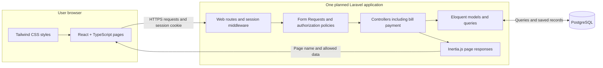

# Planned system architecture

**Status: all components and integrations here are proposed.**

## Proposed approach: one Laravel application with Inertia.js

Use Laravel for routes, authentication, validation, business rules, and database access. Use React + TypeScript for pages, connected through Inertia.js. Inertia.js lets Laravel return a React page with data while retaining Laravel routing and session authentication. Tailwind CSS styles those pages. All of this belongs to one Laravel application and one repository.

When implementation begins, use **Laravel's official React starter kit** as the starting point. It brings together React, TypeScript, Inertia.js, Tailwind CSS, and authentication scaffolding within Laravel. Reuse those foundations so you can focus on learning Bills' features. Source: [Laravel's official starter-kit documentation](https://laravel.com/docs/starter-kits).

No starter kit is installed yet. Check the then-current stable kit, its requirements, and compatible PHP/Laravel/PostgreSQL/frontend tooling versions before setup. This plan pins no framework version and includes no installation commands. Follow the selected kit's actual generated structure; see the [folder plan](06-folder-structure.md).

## What each piece means

| Planned piece | Beginner explanation | Reason for the choice |
| --- | --- | --- |
| PHP | Language that runs server-side application logic | Learn the language before relying on framework shortcuts. |
| Laravel | Framework organizing requests and backend behavior | Provides consistent places for common web application tasks. |
| React + TypeScript | Browser interface with typed component inputs | Supports interactive forms; types help catch mismatched page data during development. |
| Inertia.js | Bridge from Laravel routes to React pages | Keeps routing and sessions in one application while retaining React. |
| Tailwind CSS | Utility classes for styling | Encourages consistent spacing and responsive page layouts. |
| PostgreSQL | Persistent relational data storage | Relationships and constraints help protect financial record integrity. |
| Eloquent | Laravel's model and database relationship layer | Makes common data queries easier to express; SQL knowledge is still necessary. |

## Planned request example

1. The browser submits an expense form.
2. Laravel checks the session and CSRF protection. CSRF protection helps prevent another website from submitting an unwanted action through a user's browser session.
3. A Form Request validates amount, date, type, and referenced records. Policies decide whether the signed-in user may perform the action.
4. A controller saves the user's transaction using Eloquent. PostgreSQL enforces database constraints too.
5. Laravel redirects to an appropriate page; Inertia supplies fresh page data and React displays it.

TypeScript types are not server validation: a request can bypass the interface, so Laravel must independently check every input.

## Planned boundaries

- Scope all financial reads and writes to the authenticated user. Hiding buttons is not authorization.
- Keep database credentials on the server in environment configuration. Send only necessary fields to the browser, never secrets or password hashes.
- Reuse the official starter kit's authentication foundation and framework password hashing, session handling, and CSRF protection. Test access to Bills' private routes; authentication alone does not establish ownership of a financial record.
- Start with controllers, Form Requests, models, and policies as each feature needs them. Keep the bill payment workflow together in its controller using a database transaction. Do not pre-create custom Actions, Services, Repositories, or separate frontend/backend applications. Extract a helper later only if actual complexity or reuse justifies it; retain any authentication-specific folders supplied by the starter kit.
- Disable the payment button while a request is pending, but enforce duplicate prevention on the server: inside a database transaction, lock and re-read the owned bill and check for an existing payment before creating an expense. A second request must leave the existing payment unchanged. Undo payment must use the same locking and atomicity rules. See the [ERD constraints](04-database-erd.md).
- Use JPY only, with exact whole-yen values. Agree on storage type, range limits, and string-to-storage/display conversions before writing migrations. Avoid floating-point arithmetic and implicit JavaScript number conversion; see the [money representation decision](04-database-erd.md#planned-jpy-representation-decision-before-migrations).
- Add automated tests with each implemented feature: ownership checks, exact balances, validation, rollback, and repeated/concurrent payment requests. Use a dedicated PostgreSQL test database for database-specific constraints and locking behavior.
- Use HTTPS for a future deployed application. Deployment, backups, and recovery need their own learning step before real financial data is used.

The planned MVP uses Laravel web routes and Inertia.js throughout. A separate React application or JSON API is outside this plan.
