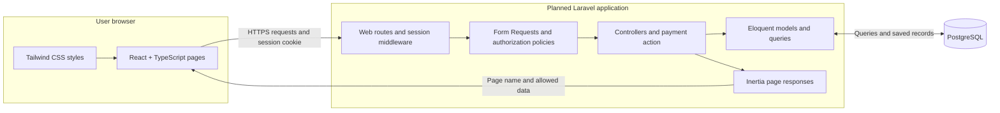

# Planned system architecture

**Status: all components and integrations here are proposed.**

## Proposed approach: one Laravel application with Inertia

Use Laravel for routes, authentication, validation, business rules, and database access. Use React + TypeScript for pages, connected through Inertia. Inertia lets Laravel return a React page with data without first building a separate REST API. Tailwind CSS styles those pages. This is a recommendation for future implementation, not an installed dependency.

## What each piece means

| Planned piece | Beginner explanation | Reason for the choice |
| --- | --- | --- |
| PHP | Language that runs server-side application logic | Learn the language before relying on framework shortcuts. |
| Laravel | Framework organizing requests and backend behavior | Provides consistent places for common web application tasks. |
| React + TypeScript | Browser interface with typed component inputs | Supports interactive forms; types help catch mismatched page data during development. |
| Inertia | Bridge from Laravel routes to React pages | Keeps routing and sessions in one application while retaining React. |
| Tailwind CSS | Utility classes for styling | Encourages consistent spacing and responsive page layouts. |
| PostgreSQL | Persistent relational data storage | Relationships and constraints help protect financial record integrity. |
| Eloquent | Laravel's model and database relationship layer | Makes common data queries easier to express; SQL knowledge is still necessary. |

## Planned request example

1. The browser submits an expense form.
2. Laravel checks the session and CSRF protection. CSRF protection helps prevent another website from submitting an unwanted action through a user's browser session.
3. A Form Request validates amount, date, type, and referenced records. Policies decide whether the signed-in user may perform the action.
4. A controller saves the user's transaction using Eloquent. PostgreSQL enforces database constraints too.
5. Laravel redirects to an appropriate page; Inertia supplies fresh page data and React displays it.

TypeScript types are not server validation: a request can bypass the interface, so Laravel must independently check every input.

## Planned boundaries

- Scope all financial reads and writes to the authenticated user. Hiding buttons is not authorization.
- Keep database credentials on the server in environment configuration. Send only necessary fields to the browser, never secrets or password hashes.
- Use framework password hashing and session authentication rather than designing custom password storage. A same-origin browser application does not need a separate token API initially.
- Keep ordinary operations in controllers and model queries. Use a focused payment action for the multi-record bill payment workflow; no general repository layer or microservices are proposed.
- Protect bill payment against repeated or concurrent submissions with a database transaction, a lock on the bill row, and a check for an existing payment.
- Use decimal-aware arithmetic for money. PostgreSQL decimal storage alone does not prevent rounding errors if application code converts amounts to floating-point numbers.
- Use HTTPS for a future deployed application. Deployment, backups, and recovery need their own learning step before real financial data is used.

A separate React frontend and Laravel JSON API remain a possible future design, but would add API contracts and authentication decisions to the initial learning workload.
