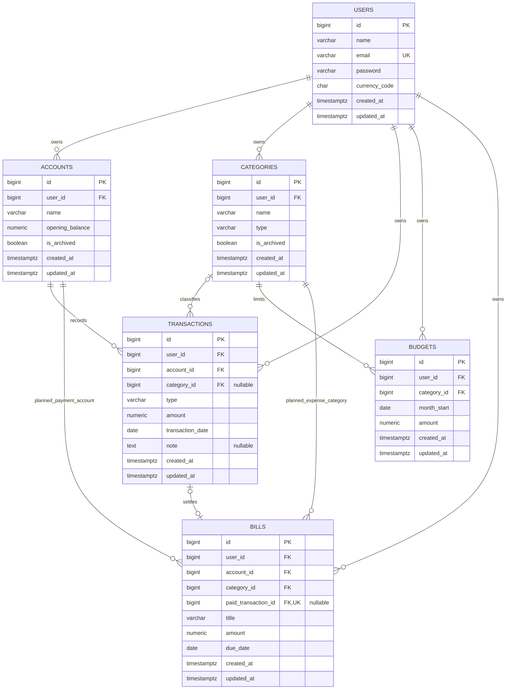

# Planned PostgreSQL database ERD

**Status: all tables, fields, constraints, and relationships are proposed. No database or migrations have been created.**

An entity is a kind of record, such as an account. A table stores those records. A primary key (`PK`) identifies one row, and a foreign key (`FK`) points to a related row. A unique key (`UK`) prevents duplicate values.

## Reading the relationships

- `||` means exactly one; `o{` means zero or many; `o|` means zero or one.
- One user may own many accounts, categories, transactions, budgets, and bills. Each of those records has exactly one owner.
- Each transaction belongs to one account and optionally one category. A category can classify many transactions.
- Each budget belongs to one expense category. Each bill names one account and one expense category for its planned payment.
- A bill may have zero or one payment transaction; a transaction may settle zero or one bill. `paid_transaction_id` is nullable and unique. PostgreSQL's normal unique constraint allows multiple nulls, so many unpaid bills can exist.

## Why these tables and fields?

| Proposed decision | Explanation |
| --- | --- |
| Separate users and financial records | Makes data ownership explicit and supports multiple private user accounts. |
| Store `user_id` on every financial table | Makes owner-scoped queries direct, but requires consistency checks with every referenced record. |
| Separate accounts and categories | An account tells where money moved; a category tells why. |
| One transaction table with a type | Income and expenses share most fields, so separate tables would duplicate logic. |
| Separate bill reminders from transactions | Money is only counted when it actually moves. A future due date alone is not spending. |
| Store only the payment link on the bill | The transaction supplies the actual payment date and amount; a duplicated paid flag could disagree. |
| A date for `month_start` | A value such as `2026-11-01` identifies a calendar month without a separate month/year pair. |
| Timestamps for record changes | Records when a row was created or edited, independently of its financial date. |
| `numeric` for monetary fields | Exact decimal storage avoids the approximate representation used by floating-point columns. |

## Planned constraints and validation

The diagram shows shape, not every SQL constraint. The following rules are part of the proposed design:

1. Use primary keys, non-null required fields, and foreign keys. Require unique email addresses with a deliberate case-normalization policy.
2. Choose explicit money precision and scale before migrations. For example, `numeric(18,2)` is appropriate only if the selected currency uses two fractional digits. Validate the currency's allowed precision and a sensible maximum amount. Keep exact decimal values through PHP and TypeScript; do not silently round them via floats.
3. Require transaction and bill amounts greater than zero; permit budget amounts of zero or greater. Opening balances may be negative to represent an account's initial state, though full debt management is outside the planned scope.
4. Limit category and transaction types to `income` or `expense`, using database CHECK constraints as well as request validation. A selected transaction category must match its type. Budgets and bills require expense categories.
5. Require `month_start` to be the first day of its month, and make `(user_id, category_id, month_start)` unique. This prevents two limits for the same category and month. Monthly actual spending is the sum of that user's expense transactions in that category from month start inclusive to next month start exclusive.
6. Require every selected account, category, and payment transaction to have the same owner as the parent row. Ordinary foreign keys to IDs alone do not enforce this. Plan composite foreign keys such as `(account_id, user_id)` referencing a unique `(id, user_id)` on accounts, and equivalent keys for categories and payment transactions. Still use Laravel ownership checks for helpful errors and access control.
7. Cross-table rules such as matching category type and matching a payment's expense type, amount, account, and category need application validation inside the payment workflow; a simple CHECK constraint cannot inspect another table. Record the actual payment date on the transaction and require full payment equal to the bill amount in the first release.
8. Lock and re-read the bill inside a database transaction before recording payment. Refuse an already linked bill. Create the expense and set the link together. A unique payment link prevents reuse of one expense across bills but does not by itself prevent two simultaneous requests creating expenses for one bill.
9. Restrict deletion of referenced accounts and categories; archive them instead. Reject new entries using archived choices while preserving historical display. Restrict deletion or financial edits of a linked payment transaction, and financial edits of a paid bill, until an explicit undo-payment action clears the link and removes its expense together. Deleting an unpaid reminder may remove just the reminder; deleting a paid reminder should require undoing its payment first.
10. Index foreign-key columns and common query paths, starting with `(user_id, transaction_date)` on transactions and `(user_id, due_date)` on bills. PostgreSQL does not automatically index referencing foreign-key columns. Revisit additional indexes using actual query needs later.

## Planned calculations, not stored duplicates

- Account balance = opening balance + all recorded income − all recorded expenses for that account. Treat opening balance as the baseline before the recorded history begins, rather than also entering it as income.
- Dashboard monthly income and expenses use transaction dates and the selected month's date range. Account balances include all recorded dates, not only the selected month. Avoid future-dated transactions in the first release; use bill reminders for future commitments.
- Budget remaining = monthly budget − matching recorded expense total. A negative result means the budget was exceeded.
- A bill is paid if its payment link exists. Otherwise its due date determines whether it is upcoming or overdue, using the application's deliberately configured user-facing timezone for today.

Recomputing these values from source records prevents stale stored totals. Framework-managed session or password-reset tables may be needed later; they are intentionally omitted from this domain diagram.
